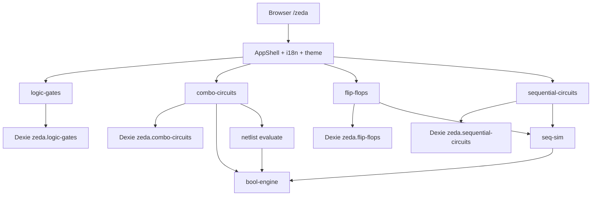

# 架构

行为验收与 capability 边界以 [`openspec/specs/`](../openspec/specs/) 为准；本文描述实现结构与仿真分层。

## 定位

纯前端 SPA：学习与理想模型仿真。无服务端业务逻辑；持久化仅浏览器 IndexedDB。静态资源部署于 Cloudflare Workers（SPA `not_found_handling`）。

## 运行时拓扑

## 源码分层

| 层 | 路径 | 职责 |
|----|------|------|
| 入口 | `src/main.tsx`、`App.tsx` | 挂载、根组件 |
| 应用壳 | `src/app/` | Router、Providers |
| 布局 | `src/components/layout/` | Header / Sidebar / Footer / Shell |
| 共享 UI | `src/components/ui/`、`timing-wave` 等 | shadcn 封装、波形条 |
| 特性 | `src/features/*` | 按领域垂直切片（types / db / lib / components / pages） |
| 基础设施 | `src/lib/`、`src/i18n/` | Snowflake、cn、语言包 |

路径别名：`@/` → `src/`。

## 特性边界

每个特性是**独立产品切片**：独立 Dexie 库、独立 seed/repository、独立路由与 i18n 文案域。跨特性只允许：

- 复用壳层与 UI 模式  
- 复用 `logic-gates` 的门符号、公式求值、门列表作叶子  
- 时序侧：`sequential-circuits` 引用 **FF 目录模块**（`ff-modules`），并通过共享 `seq-sim` 求值  
- **禁止**把另一特性的整张业务表「合并进」本库，或静默改对方 schema  

### 组合 vs 时序仿真

| | 组合 `netlist.ts` | 时序 `seq-sim.ts` |
|--|-------------------|-------------------|
| 状态 | 无 | 有（Q / 模块内部状态） |
| 时钟 | 无 | 电平敏感 / 理想边沿 / 异步优先 |
| 环路 | 组合环报错 | 无状态源隔断的纯组合环报错；纹波用 delta 迭代 |
| 权威求值 | 拓扑排序 + 门/模块公式 | 行为 `step` + 组合云 DAG |

扩展时序能力时改 `seq-sim`（及模块目录），不要把时钟语义塞进 combo `netlist`。

## 数据权威

| 实体 | 持久化权威 | 派生（不落库或懒算） |
|------|------------|----------------------|
| LogicGate | `formulas` + 引脚元数据 | 真值表页 |
| ComboCircuit | 节点 + 线 + 对外 IO | 电路级真值表（若有） |
| FlipFlopCircuit / SequentialCircuit | 网表 + `behaviorKey` / 模块 `step` | 功能表、状态图、波形采样 |

导入导出 JSON 带 `version: 1`；读入走 `normalize*`，兼容缺省字段。

## 层次与下钻

- **组合**：内置/74LS 可有门级 `internals`；自定义电路可经 `kind:'circuit'` 嵌套其它组合电路（环检测）。  
- **触发器**：目录种子层次化 internals；下钻只读；仿真权威在行为模块。  
- **时序**：可嵌套其它 **SequentialCircuit**（环检测）；下钻路径 seq → FF → 门；下钻时跳过仿真。  

## 前端壳

- `BrowserRouter basename="/zeda"`  
- Vite `base: '/zeda/'`  
- 主题：`next-themes`；语言：localStorage 记忆  
- 侧栏四入口：逻辑门 / 组合电路 / 触发器 / 时序电路  

## 部署

1. `pnpm build` → `tsc -b` + `vite build` + `scripts/prepare-cf-assets.mjs`  
2. `wrangler.jsonc`：`assets.directory = ./dist`，SPA 回退  
3. `pnpm deploy` = build + `wrangler deploy`  

预览与 workers.dev / preview URL 由 Wrangler 配置启用。

## 演进方向（架构层）

北星与阶段划分见 [roadmap.md](./roadmap.md)。架构层约束：

- **简易 CPU、汇编工具链、程序运行 UX** → 新建独立 `src/features/*` 切片（独立路由 / Dexie / i18n），**禁止**继续膨胀 `sequential-circuits` 成「万能时序袋」  
- CPU 周期推进：建立在 `seq-sim` 或其上的 CPU 运行时；**禁止**把指令语义塞进 combo `netlist.ts`  
- 通路积木（ALU/MUX 等）优先以可复用模块 + internals 下钻进入既有 combo/seq 目录，再被 CPU 引用  
- 热点求值 WASM 化（布尔 / 大网表 / 长波形 / CPU 步进）时，保持 JS 侧 API 与「权威数据」不变  
- 云同步若引入，应作为仓储适配层，而不是改掉领域模型  
