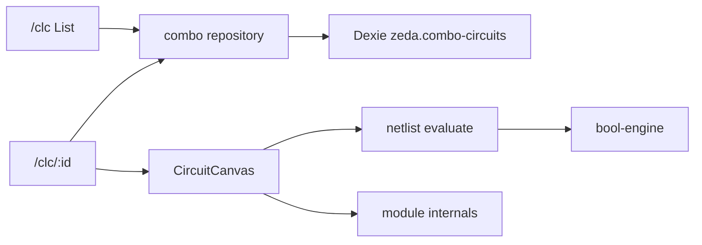

# Design: combo-circuits

## Context

阶段二。复用 logic-gates 门库与 `bool-engine`、`GateSymbol`、列表 UX、`useHistoryState`。溯源：[`docs/task/step1/task02.md`](../../../docs/task/step1/task02.md)。

## Goals / Non-Goals

**Goals**：组合网表编辑与求值、冻结教材电路 + 3 颗 74LS 代表、下钻。

**Non-Goals**：时钟/波形、完整 74 系列、WASM/后端；布线优化与表达式综合为扩展 change。

## Decisions

| 决策 | 理由 |
|------|------|
| 独立库 `zeda.combo-circuits` | 不污染门数据 |
| 求值在 `lib/netlist.ts` | 纯组合 DAG；禁止当后续时序/CPU 内核 |
| 74LS 种子 custom 可编辑 | 代表件可拆改学习；教材 builtin 只读 |
| 允许 `kind:'circuit'` 嵌套 | 实现已支持（相对 task02 初稿放宽） |
| localStorage `zeda.circuits.*` | 与列表分页等 UX 记忆 |

## Data model (semantic)

```ts
type CircuitPin = { id: string; name: string }

type CircuitNode =
  | { id: string; kind: 'gate'; ref: { builtinKey?: string; gateId?: string }; position: { x: number; y: number } }
  | { id: string; kind: 'module'; moduleKey: string; position: { x: number; y: number } }
  | { id: string; kind: 'circuit'; circuitId: string; position: { x: number; y: number } } // 实现已支持

type CircuitWire = {
  id: string
  from: { nodeId: 'io' | string; pinId: string }
  to: { nodeId: 'io' | string; pinId: string }
}

type ComboCircuit = {
  id: string
  name: string
  description?: string
  kind: 'builtin' | 'custom'
  builtinKey?: string
  inputs: CircuitPin[]
  outputs: CircuitPin[]
  nodes: CircuitNode[]
  wires: CircuitWire[]
  createdAt: number
  updatedAt: number
}
```

约束：门引用失败明确报错；嵌套环明确报错；不嵌套 FF/Seq 实体表。

## Architecture sketch



## Key paths

```
src/features/combo-circuits/
  types.ts
  db/
  lib/netlist.ts
  lib/modules.ts
  lib/internals.ts
  components/CircuitCanvas.tsx
  components/ModulePalette.tsx
  components/CircuitSidePanel.tsx
  components/CircuitMetaPanel.tsx
  pages/
# 扩展待建：lib/layout.ts、routing.ts、synth-from-expr.ts
```

## Verification

见 `spec.md` Verification；扩展落地后另验：整理布线可 undo；`Y = A AND B` 等可综合为可仿真网表。

## Risks

大数据通路可读性依赖后续布局布线；表达式综合是通向 CPU ALU 的高杠杆项（roadmap P5 相关）。
