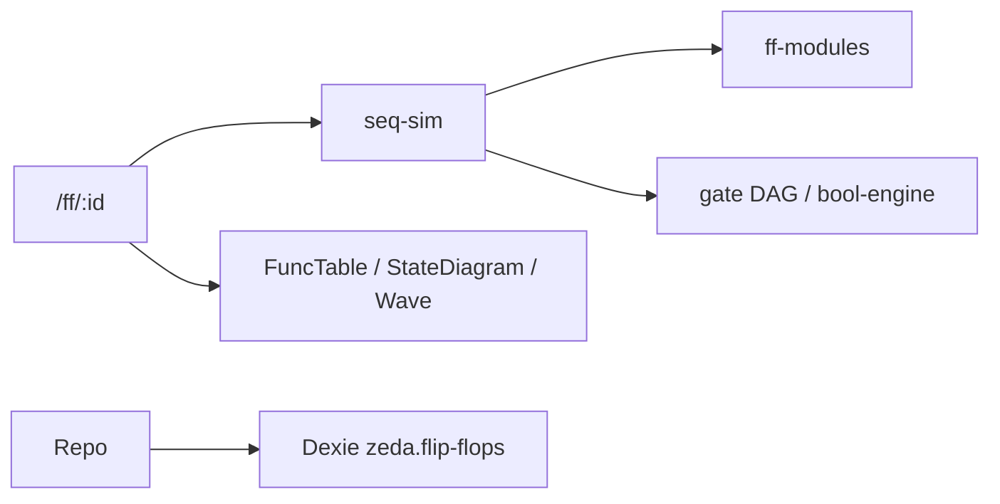

# Design: flip-flops

## Context

阶段三（step2 第一步）。计划见 `.cursor/plans/触发器电路管理_*.plan.md`；规格见 [`docs/task/step2/task03.md`](../../../docs/task/step2/task03.md)。

## Goals / Non-Goals

**Goals**：FF 管理闭环、理想时钟、三图、层次 internals、可复用 `ff-modules` + `seq-sim`。

**Non-Goals**：寄存器/计数器产品封装（阶段四）、方程综合主闭环、延时模型、改 combo schema。

## Decisions

| 决策 | 理由 |
|------|------|
| 新建 `seq-sim`，不扩展 combo netlist | 组合禁环无状态；时序需时钟与状态 |
| 全目录 builtin 只读（含 74LS） | 统一「复制后改」；相对初稿「74LS 为 custom」有演进 |
| 基本 RS 用 `behaviorKey` | 交叉耦合不宜当纯组合 DAG |
| T′ 语义写死 | 与 T 互补，避免教材歧义 |
| `FF_LAYOUT_REV` | bump 后重写种子拓扑 |
| 选 74ls112 而非 76 | 避免主从/边沿型号混乱 |

## Data model (semantic)

```ts
type CircuitPin = { id: string; name: string; drive?: 'signal' | 'clk' | 'vcc' | 'gnd' }

type FfNode =
  | { id: string; kind: 'gate'; ref: { builtinKey?: string; gateId?: string }; position: { x: number; y: number } }
  | { id: string; kind: 'ff'; moduleKey: string; position: { x: number; y: number } }

type FlipFlopCircuit = {
  id: string
  name: string
  description?: string
  kind: 'builtin' | 'custom'
  builtinKey?: string
  behaviorKey?: string
  group: string
  inputs: CircuitPin[]
  outputs: CircuitPin[]
  nodes: FfNode[]
  wires: CircuitWire[]
  createdAt: number
  updatedAt: number
}
```

约束：自定义 FF 电路在本阶段规格中**不**再嵌套另一自定义 FF 实体（层级封装交给 sequential 的 seq 嵌套）；复合种子用嵌套 `ff` 节点。

## Simulation architecture



求值要点：拆组合子图 + FF 节点；组合拓扑排序；电平/边沿/异步优先；波形有限步推进。

## Key paths

```
src/features/flip-flops/
  types.ts
  db/                              # FF_LAYOUT_REV
  lib/ff-modules.ts
  lib/seq-sim.ts                   # 阶段四注入扩展
  lib/func-table.ts
  lib/state-diagram.ts
  lib/internals.ts
  lib/groups.ts
  lib/pin-drive.ts
  components/                      # Canvas、三图、侧栏
  pages/
src/components/timing-wave.tsx     # 若共用
src/i18n/locales/                  # flipflops
```

## Verification

见 `spec.md`。扩展：方程生成、波形仪游标等另验。

## Risks

理想时钟适合教学，不适合 STA；`__clk2` 等双时钟 hack 待一等公民化。
