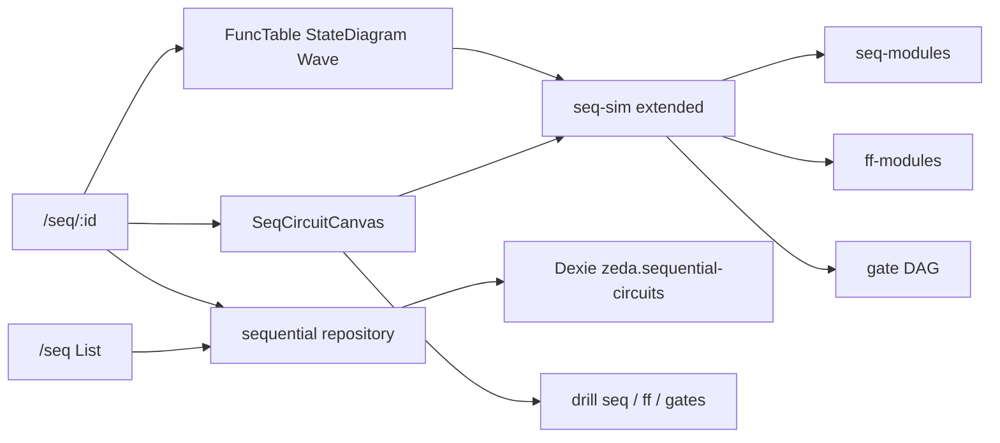

# Design: sequential-circuits

## Context

阶段四（step2 第二步）。计划见 `.cursor/plans/时序电路管理_*.plan.md`；规格见 [`docs/task/step2/task04.md`](../../../docs/task/step2/task04.md)。

复用：`ff-modules`、FF `internals` 构图助手、泛化后的 `seq-sim`、列表/详情 UX。

## Goals / Non-Goals

**Goals**：寄存器/计数器/代表 TTL 管理闭环；层次复用 FF；下钻到门；共享仿真内核且 `/ff` 无回归。

**Non-Goals**：完整 74 系列、任意 N 向导、FSM 编辑器、ALU/CPU（→ roadmap 独立 feature）、改 combo/ff schema、延时模型。

## Decisions

| 决策 | 理由 |
|------|------|
| 独立实体与 Dexie 库 | 不把大时序并入 `/ff` 列表；不改 FF schema |
| 注入式模块解析扩展 `seq-sim` | FF 与 Seq 统一 `step`，避免两套仿真 |
| 纹波有限 delta 迭代 | 避免单遍节点顺序依赖 |
| 可嵌套其它 SequentialCircuit | 对齐 combo 的 `kind:'circuit'`；环检测 |
| 仅引用 FF **目录**模块 | 不嵌套 FlipFlopCircuit 实体行 |
| 种子全 builtin + `SEQ_LAYOUT_REV` | 可重写拓扑；复制后改 |
| 模 6 代表 + up/down 覆盖减法 | 控制冻结种子规模 |

## Data model (semantic)

```ts
type CircuitPin = { id: string; name: string; drive?: 'signal' | 'clk' | 'vcc' | 'gnd' }

type SeqNode =
  | { id: string; kind: 'gate'; ref: { builtinKey?: string; gateId?: string }; position: { x: number; y: number } }
  | { id: string; kind: 'ff'; moduleKey: string; position: { x: number; y: number } }
  | { id: string; kind: 'seq'; moduleKey: string; position: { x: number; y: number } }
  | { id: string; kind: 'circuit'; circuitId: string; position: { x: number; y: number } }

type SequentialCircuit = {
  id: string
  name: string
  description?: string
  kind: 'builtin' | 'custom'
  builtinKey?: string
  behaviorKey?: string
  group: string
  inputs: CircuitPin[]
  outputs: CircuitPin[]
  nodes: SeqNode[]
  wires: CircuitWire[]
  createdAt: number
  updatedAt: number
}
```

## Architecture sketch



## Key paths

```
src/app/router.tsx
src/components/layout/AppSidebar.tsx
src/features/flip-flops/
  lib/ff-modules.ts
  lib/seq-sim.ts                   # 共享内核
  lib/internals.ts                 # FF 构图助手
src/features/sequential-circuits/
  types.ts
  db/                              # SEQ_LAYOUT_REV
  lib/seq-modules.ts
  lib/internals.ts
  lib/evaluate.ts
  lib/func-table.ts
  lib/state-diagram.ts
  lib/groups.ts
  lib/pin-drive.ts
  components/
  pages/
src/i18n/locales/                  # sequential
```

## Verification

见 `spec.md` Verification。扩展：模 N 向导、波形仪游标等另验。

## Risks / Trade-offs

宽位全输入功能表易爆炸——默认分页/激励子集。CPU 整机勿继续塞进本 feature（见 `docs/roadmap.md` P8）。
